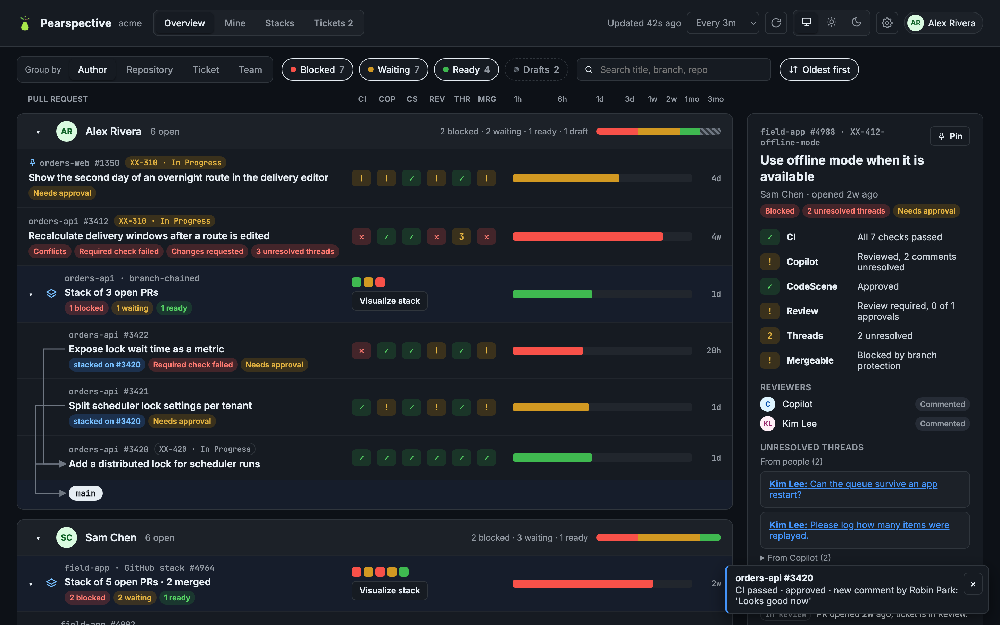
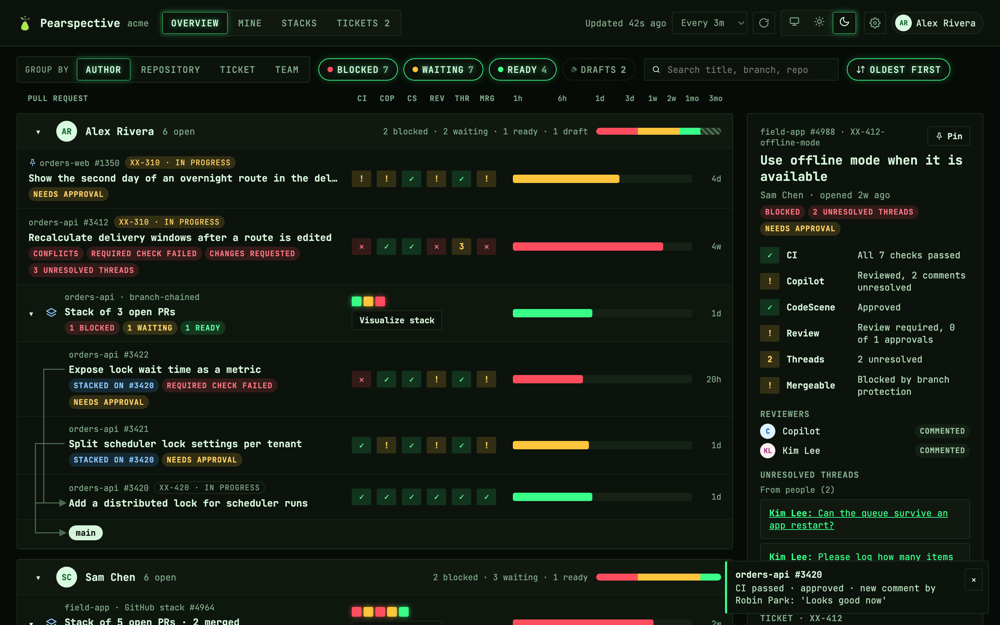

<p align="center">
  
</p>

<h1 align="center">Pearspective</h1>

<p align="center"><b>Every open pull request in your organisation, in perspective.</b></p>

<p align="center">
  
  <br><sub>Screenshot of the interactive mockup in <code>docs/mockup/overview-swimlanes.html</code>, with made-up data.</sub>
</p>

---

GitHub shows pull requests one repository at a time. When a team works across a handful of repositories, the questions you actually ask are spread over many tabs: *What is blocked, and why? What is waiting for me? Which stack is stuck behind its base?*

Pearspective is a small local dashboard that answers them on one screen. It reads open PRs from up to ten repositories through your logged-in `gh` CLI, works out what each PR is waiting for, and lays them out in swimlanes. It is read-only: it never comments, approves, merges or pushes. It listens on `127.0.0.1` only.

## What you get

- **Overview** in swimlanes, grouped by author, repository, ticket or team (a PR shows under each of its author's teams). Rows are sorted blocked → waiting → ready, oldest first (or newest first).
- **Six status squares per PR**: CI, AI review (Copilot), code analysis (CodeScene), human review, unresolved threads and mergeability. Hover a square for the detail, such as which required check failed.
- **Clear buckets.** Every PR is *blocked*, *waiting for review*, *ready* or a *draft*, with a badge saying why (conflicts, changes requested, required check failed, and so on). Missing or truncated data never shows as green.
- **Age at a glance.** A log-scale bar from 1 hour to 3 months, coloured by bucket.
- **Mine**: your PRs, reviews requested from you, and reviews requested from your team.
- **Stacked PRs**: GitHub's native stacks and branch-chained PRs are grouped, drawn with merge-direction connectors, and shown as zoomable D3 diagrams on the Stacks tab.
- **Pinning.** Pin a PR from its detail panel and it stays at the top of its lane, whatever the sort order. Pins are saved in `config.json`.
- **Detail panel** that stays in view while you scroll: failing checks, reviewers, unresolved threads (people's first, automated reviewers' folded away), the ticket with its other PRs, and the stack the PR belongs to.
- **Ticket links.** Jira-style keys in branch names or titles (`XX-123`) become links when an issue tracker is configured.
- **Ticket status (optional).** With [jira-cli](https://github.com/ankitpokhrel/jira-cli) set up, each PR shows its ticket's status, and a **Tickets** tab lists tickets whose status disagrees with their PRs, for example a merged PR whose ticket is still *In Review*. A **Mine** filter narrows it to tickets you are or were assigned to or have a pull request for, and the detail panel jumps to a PR's ticket there.
- **Notifications.** While a dashboard tab is open, you are told when CI fails or passes, a review lands, a conflict appears, or someone comments on one of your PRs: as a toast when the tab is visible, as a browser notification when it is in the background.
- **Instant start.** The last state is kept in a local SQLite file, so a restart shows the board at once while the first refresh fetches only what changed.
- **Themes.** Default (light and dark, following the system) and Terminal, plus your own as small JSON files.
- **Links that work.** Every view and opened PR has its own URL, and the browser's Back and Forward move between them.

## Requirements

- Node 22 or newer
- [GitHub CLI](https://cli.github.com/), logged in: `gh auth status` must show an active account with the `repo` and `read:org` scopes
- macOS or Linux (Windows is untested)

## Quick start

Clone Pearspective next to the repositories you work on, for example into `~/Projects/pearspective`, then:

```bash
npm install
npm run setup     # choose up to 10 repositories; writes config.json
npm run dev       # API on http://127.0.0.1:4100, UI on http://127.0.0.1:5173
```

`npm run setup` suggests sensible defaults:

- **Folder:** the parent folder of the Pearspective checkout. It scans it for git clones.
- **Organisation:** taken from your `gh` login. If you belong to several, it picks the one most of your local clones point at.
- **Repositories:** ranked by your recent PR activity and their number of open PRs.

To run without the dev server, build the UI once and serve everything from the API:

```bash
npm run build && npm start   # http://127.0.0.1:4100
```

To change the repositories later, use the settings button in the header (**Repositories** tab), or run `npm run setup` again. Settings also has **Notifications** and **Appearance** tabs.

## Configuration

`config.json` is gitignored. [`config.example.json`](config.example.json) shows the shape.

| Key | Meaning |
| --- | --- |
| `codeHost.org` | The GitHub organisation. |
| `codeHost.repos` | The Overview repositories (max 10). |
| `codeHost.excludeRepos` | Repositories to leave out of the Overview even if listed. |
| `codeHost.localRepos` | Repositories cloned next to Pearspective, found by setup; the settings panel marks the others "not cloned". |
| `codeHost.teams` | Teams for the "Review requested from my team" section. Detected by setup. |
| `reviewerClasses` | Which bot logins count as AI review and code analysis. A trailing `*` matches a prefix. |
| `refreshIntervalSec` | `0` (off), `180`, `300`, `600`, `900` or `1800`. Also editable from the header. |
| `pinned` | IDs of pinned PRs. Managed from the detail panel. |
| `issueTracker` | Optional. Ticket links, and with jira-cli the ticket status and mismatch checks; see [Ticket status](#ticket-status-optional). |
| `notifications` | Optional. Notifications on your PRs; see [Notifications](#notifications). |
| `databasePath` | Optional. Where the local database lives; default `pearspective.db` next to `config.json`. See [Local database](#local-database). |
| `theme` | Optional. The theme id (file name), default `default`. Usually set from the Appearance tab. |

## Ticket status (optional)

Pearspective reads tickets through [jira-cli](https://github.com/ankitpokhrel/jira-cli), which works with Jira Cloud and with self-hosted Jira Server / Data Center. Pearspective never sees your token; jira-cli handles authentication.

1. Install jira-cli and give it a token. For Server / Data Center, create a personal access token in your Jira profile. jira-cli looks for the token in `JIRA_API_TOKEN`, then in `~/.netrc`, then in the keychain. Because Pearspective's server runs jira-cli itself, a `.netrc` entry is the most reliable choice:

   ```
   machine jira.example.com
     login jdoe
     password <your token>
   ```

   On Windows, jira-cli reads `%USERPROFILE%\_netrc` (with an underscore) instead of `~/.netrc`, so name the file `_netrc`, or set the `NETRC` environment variable to the file's path.

   `machine` must be the bare host (no `https://`, no path). `login` must equal the `login:` that `jira init` writes to `~/.config/.jira/.config.yml`. With a personal access token, `jira init` replaces the login you type (say, your email) with your Jira username, so check that file afterwards and add a second `.netrc` entry with the same token if they differ.
2. Run `jira init` (installation type **Local** and auth type **bearer** for a personal access token) and check that `jira me` prints your username.
3. Add an `issueTracker` block to `config.json` and restart the server:

   ```json
   "issueTracker": {
     "provider": "jira",
     "baseUrl": "https://jira.example.com",
     "expectedStatuses": { "open": ["In Review"], "merged": ["Ready for Test", "Done"] }
   }
   ```

These are optional keys inside the `issueTracker` block: `ticketStatus` (`true`; `false` keeps only the ticket links), `expectedStatuses`, `closedLookbackDays` (14), `ignoreBases` (`["release/*"]`), `graceMinutes` (30) and `refreshIntervalSec` (600).

Upgrading: a config that already has an `issueTracker` block for ticket links now gets ticket status too. To keep only the links, set `"ticketStatus": false` inside `issueTracker`.

How tickets are judged:
- Keys are taken from branch names and titles of open PRs and of PRs merged or closed in the last `issueTracker.closedLookbackDays` (default 14) in your repositories.
- PRs into branches matching `issueTracker.ignoreBases` (default `["release/*"]`) do not count.
- The least-finished PR decides what the ticket should be: a draft or open PR expects work in progress, merged PRs expect anything but *To Do*, and PRs closed without merging ask a human to look.
- Without `issueTracker.expectedStatuses`, Jira's built-in categories (To Do / In Progress / Done) are used. Listing status names per PR state (`draft`, `open`, `merged`, `abandoned`) makes the check precise, for example to catch a merged PR whose ticket is still *In Review*.
- A change is not flagged until it has lasted `issueTracker.graceMinutes` (default 30). Tickets are refreshed every `issueTracker.refreshIntervalSec` (default 600, separate from the top-level `refreshIntervalSec` that controls PR polling) and only while a dashboard tab is visible.

## Notifications

Turn them on in the settings panel's **Notifications** tab (or add a `notifications` block to `config.json`), then click **Allow desktop notifications** once per browser.

```json
"notifications": {
  "enabled": true,
  "events": { "reviewRequested": true }
}
```

- Events: `ciFailed`, `ciPassed`, `approved`, `changesRequested`, `readyToMerge`, `conflict`, `newComment`, `newThread` (all on by default) and `reviewRequested` (off by default). List only the ones you want to change.
- Only your own PRs notify, except "review requested". Your own comments and threads, and comments from bots and code-analysis tools, never do.
- Several changes on one PR arrive as one notification; more than three PRs at once arrive as one summary.
- After a restart, changes made while Pearspective was stopped arrive as one notification (or a summary) once the first full refresh completes.
- While tabs are open but hidden, the server keeps polling every 5 minutes, including the full sweep every 15 minutes. At ~280 PRs that is about 400 GitHub points an hour (4 × 75 + 8 × 13). Ticket status is not refreshed meanwhile. Hidden polling is off when auto-refresh is off (`refreshIntervalSec: 0`). With no dashboard tab open, nothing is polled and nothing notifies.

## Local database

Pearspective keeps its latest state (pull requests, checks, reviews, threads, tickets) in a local SQLite file, so a restart shows the last data at once, marked "Showing data from …, updating…", while the first refresh fetches only what changed.

- The file is `pearspective.db` next to `config.json`. Set `databasePath` to put it elsewhere, for example outside the checkout, so your org's PR and ticket data never sits in the repository folder.
- Only the current state is stored. PRs that close, merge or leave your selection are deleted on the next full refresh.
- The file is a cache: stop Pearspective and delete `pearspective.db` (and the `pearspective.db-wal` and `pearspective.db-shm` files next to it) whenever you like; it is rebuilt on the next start. If it cannot be opened, a banner says so and Pearspective works as before, loading everything from GitHub on each start.
- One file holds every org you have configured; the board shows only the current org and repositories. Tickets and your team list are shared between orgs.

## Themes

Pick a theme in the settings panel's **Appearance** tab. **Default** follows your light/dark setting; **Terminal** is dark only, with a monospace font, tighter corners and a soft green glow on the active tab and filters.



Make your own by putting a JSON file in the `custom-themes/` folder next to `config.json` (it is created on the first start and kept out of git). Saving the file updates open tabs within a second. If your system can't watch the folder for changes, restart Pearspective to pick up edits.

```json
{
  "$schema": "./theme.schema.json",
  "name": "Calm",
  "modes": ["dark"],
  "dark": { "colors": { "accent": "#88ccff", "ready": "#6fdc8c" } }
}
```

- Anything you leave out comes from Default, so a theme can be a few lines.
- [`theme.schema.json`](themes/theme.schema.json) (copied into the folder) lets your editor autocomplete colour names and check the file. A broken file is listed in the picker with the problem and never breaks the page.
- Themes set colours, fonts, the base font size (body text only; smaller sizes stay fixed), corner radii, border width, shadows, label casing and an optional accent glow (`"effects": { "glow": true }`); they cannot change the layout.
- To use your own font, put the theme in a folder (`custom-themes/calm/theme.json`) with its `.woff2` files beside it and list them under `fontFiles`. Theme font files are served by Pearspective itself.
- A file with the same name as a built-in theme (for example `default.json`) replaces it, unless the file is invalid; then the built-in stays and shows a warning. The file name (lower-cased) is the theme's id, so it may contain only letters, digits and dashes.

## How it uses the GitHub API

Pearspective is careful with your GraphQL budget (5,000 points an hour):

- **Cheap poll:** while a dashboard tab is visible, one query per refresh lists the open PRs in your repositories. With notifications off, nothing is polled while every tab is hidden.
- **Full details:** fetched only for PRs that changed or still have checks running, 25 per request, three requests at a time.
- **Full sweep:** every 15 minutes.
- **Measured cost**, with 10 repositories, one team and 277 open PRs: a full sweep (also the first load) costs about 75 points and an ordinary refresh about 13. At the default 3-minute interval that is roughly 500 points an hour. It grows with the number of open PRs and with how many have checks running. Under 500 remaining points, a banner appears and refreshes slow down.

## Troubleshooting

- **"gh is not logged in"**: run `gh auth login`, or `gh auth switch` if the wrong account is active. The header shows which login is in use.
- **"Last refresh failed …"**: the data shown is from the last good refresh, and the banner says why it failed.
- **The server log** prints one line per refresh with the PR count and the API points left.
- **"Local database unavailable …"**: the database file could not be opened; Pearspective works as before but loads everything from GitHub on each start. Stop it, delete `pearspective.db` and its `-wal`/`-shm` files, and start again.
- **"Theme '…' is unavailable …"**: the chosen theme file is missing or invalid, so Default is used. The Appearance tab shows what is wrong with the file.

## Development

```bash
npm test                 # Vitest
npm run typecheck
npm run themes:schema    # regenerate themes/theme.schema.json after changing the theme schema
npm run db:generate      # generate a database migration after changing server/storage/schema.ts
scripts/build-icons.sh   # regenerate the favicons from the SVGs in docs/assets (macOS, needs Chrome)
```

The code is split into `shared/` (the provider-neutral model and status rules), `server/` (Express, the poller and the GitHub provider, which shells out to `gh api graphql`) and `web/` (React, Vite and D3).

- Design: [`docs/design.md`](docs/design.md)
- Interactive mockup: [`docs/mockup/overview-swimlanes.html`](docs/mockup/overview-swimlanes.html), which opens straight in a browser
- Ideas for v2: [`docs/v2-proposal.md`](docs/v2-proposal.md)

## License

[MIT](LICENSE)
