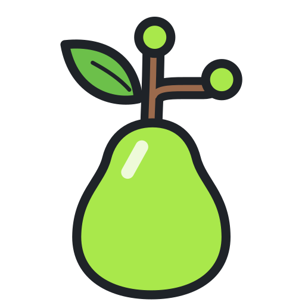

<p align="center">
  
</p>

<h1 align="center">Pearspective</h1>

<p align="center"><b>Every open pull request in your organisation, in perspective.</b></p>

<p align="center">
  
  <br><sub>Screenshot of the interactive mockup in <code>docs/mockup/overview-swimlanes.html</code>, with made-up data.</sub>
</p>

---

GitHub shows pull requests one repository at a time. When a team works across a handful of repositories, the questions you actually ask are spread over many tabs: *What is blocked, and why? What is waiting for me? Which stack is stuck behind its base?*

Pearspective is a small local dashboard that answers them on one screen. It reads open PRs from up to ten repositories through your logged-in `gh` CLI, works out what each PR is waiting for, and lays them out in swimlanes. It is read-only: it never comments, approves, merges or pushes. It listens on `127.0.0.1` only.

## What you get

- **Overview** in swimlanes, grouped by author, repository or ticket. Rows are sorted blocked → waiting → ready, oldest first (or newest first).
- **Six status squares per PR**: CI, AI review (Copilot), code analysis (CodeScene), human review, unresolved threads and mergeability. Hover a square for the detail, such as which required check failed.
- **Clear buckets.** Every PR is *blocked*, *waiting for review*, *ready* or a *draft*, with a badge saying why (conflicts, changes requested, required check failed, and so on). Missing or truncated data never shows as green.
- **Age at a glance.** A log-scale bar from 1 hour to 3 months, coloured by bucket.
- **Mine**: your PRs, reviews requested from you, and reviews requested from your team.
- **Stacked PRs**: GitHub's native stacks and branch-chained PRs are grouped, drawn with merge-direction connectors, and shown as zoomable D3 diagrams on the Stacks tab.
- **Pinning.** Pin a PR from its detail panel and it stays at the top of its lane, whatever the sort order. Pins are saved in `config.json`.
- **Detail panel** that stays in view while you scroll: failing checks, reviewers, unresolved threads, related PRs for the same ticket, and the stack the PR belongs to.
- **Ticket links.** Jira-style keys in branch names or titles (`XX-123`) become links when an issue tracker is configured.
- **Light and dark themes**, following the system by default.

## Requirements

- Node 22 or newer
- [GitHub CLI](https://cli.github.com/), logged in: `gh auth status` must show an active account with the `repo` and `read:org` scopes
- macOS or Linux (Windows is untested)

## Quick start

Clone Pearspective next to the repositories you work on, for example into `~/Projects/pearspective`, then:

```bash
npm install
npm run setup     # choose up to 10 repositories; writes config.json
npm run dev       # API on http://127.0.0.1:4100, UI on http://127.0.0.1:5173
```

`npm run setup` suggests sensible defaults:

- **Folder:** the parent folder of the Pearspective checkout. It scans it for git clones.
- **Organisation:** taken from your `gh` login. If you belong to several, it picks the one most of your local clones point at.
- **Repositories:** ranked by your recent PR activity and their number of open PRs.

To run without the dev server, build the UI once and serve everything from the API:

```bash
npm run build && npm start   # http://127.0.0.1:4100
```

To change the repositories later, use the settings button in the header, or run `npm run setup` again.

## Configuration

`config.json` is gitignored. [`config.example.json`](config.example.json) shows the shape.

| Key | Meaning |
| --- | --- |
| `codeHost.org` | The GitHub organisation. |
| `codeHost.repos` | The Overview repositories (max 10). |
| `codeHost.teams` | Teams for the "Review requested from my team" section. Detected by setup. |
| `reviewerClasses` | Which bot logins count as AI review and code analysis. A trailing `*` matches a prefix. |
| `refreshIntervalSec` | `0` (off), `180`, `300`, `600`, `900` or `1800`. Also editable from the header. |
| `pinned` | IDs of pinned PRs. Managed from the detail panel. |
| `issueTracker` | Optional, e.g. `{ "provider": "jira", "baseUrl": "https://jira.example.com" }`, to make ticket keys clickable. |

## How it uses the GitHub API

Pearspective is careful with your GraphQL budget (5,000 points an hour):

- **Cheap poll:** while a dashboard tab is visible, one query per refresh lists the open PRs in your repositories. Nothing is polled while every tab is hidden.
- **Full details:** fetched only for PRs that changed or still have checks running, 25 per request, three requests at a time.
- **Full sweep:** every 15 minutes.
- **Measured cost**, with 10 repositories, one team and 277 open PRs: a full sweep (also the first load) costs about 75 points and an ordinary refresh about 13. At the default 3-minute interval that is roughly 500 points an hour. It grows with the number of open PRs and with how many have checks running. Under 500 remaining points, a banner appears and refreshes slow down.

## Troubleshooting

- **"gh is not logged in"**: run `gh auth login`, or `gh auth switch` if the wrong account is active. The header shows which login is in use.
- **"Last refresh failed …"**: the data shown is from the last good refresh, and the banner says why it failed.
- **The server log** prints one line per refresh with the PR count and the API points left.

## Development

```bash
npm test                 # Vitest
npm run typecheck
scripts/build-icons.sh   # regenerate the favicons from the SVGs in docs/assets (macOS, needs Chrome)
```

The code is split into `shared/` (the provider-neutral model and status rules), `server/` (Express, the poller and the GitHub provider, which shells out to `gh api graphql`) and `web/` (React, Vite and D3).

- Design: [`docs/design.md`](docs/design.md)
- Interactive mockup: [`docs/mockup/overview-swimlanes.html`](docs/mockup/overview-swimlanes.html), which opens straight in a browser
- Ideas for v2: [`docs/v2-proposal.md`](docs/v2-proposal.md)

## License

[MIT](LICENSE)
